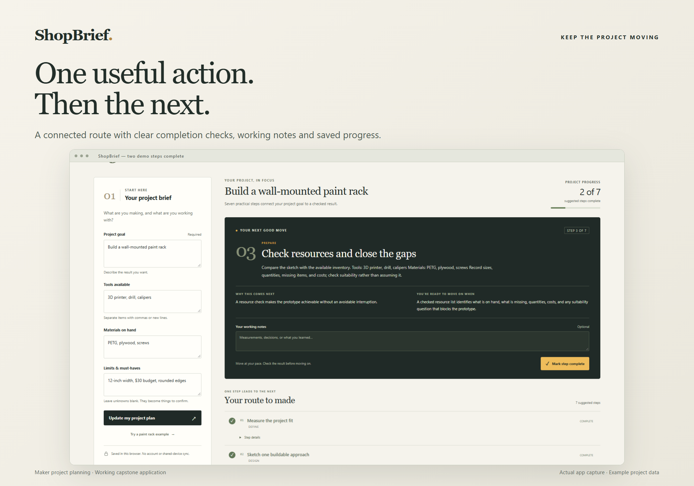

# ShopBrief

MS628 Cloud Computing — Assignment 7.1: Final Project — Capstone

ShopBrief is a web application for turning a maker-project idea into a practical starting plan. It uses a project goal, available tools, materials, and constraints to produce clear requirements, resource lists, open questions, and an ordered route of suggested actions.



## Features

- A four-part project brief covering goal, tools, materials, and limits.
- Constraint-aware recommendations with a next action, its purpose, and a completion check.
- An ordered action route with progress tracking, step notes, and the ability to reopen earlier steps.
- Browser-local saving so the current project can be restored after reloading.
- A responsive interface with keyboard-friendly form controls and clear error messages.
- A health-check endpoint and container-based deployment.

Recommendations are deterministic planning guidance. They do not certify engineering decisions, material suitability, or completion of physical work.

## Run with Docker

From the repository directory:

```powershell
docker build -t shopbrief-capstone:1.0.0 .
docker run --rm -p 127.0.0.1:8088:5000 shopbrief-capstone:1.0.0
```

Open `http://127.0.0.1:8088/`. Health check: `http://127.0.0.1:8088/healthz`.

## Run on Windows without Docker

Use Python 3.11 or newer:

```powershell
python -m venv .venv
.\.venv\Scripts\python.exe -m pip install -r requirements.txt
.\.venv\Scripts\python.exe -m waitress --listen=127.0.0.1:8088 app:app
```

## Tests

Run the Python planner and Flask tests:

```powershell
python -B -m unittest discover -s tests -v
```

Optional browser tests require the application running, Node.js, and Playwright:

```powershell
npm install
npx playwright install chromium
npm run test:browser
```

Browser test results are written locally to `docs/browser-results.json` and excluded from Git.

## Usability testing

A simulated maker-project scenario exercised project entry, planning recommendations, action progress, and restoring saved work. The observations and retest outcomes are summarized in [usability testing](docs/USER_TESTING.md).

## Advertisement screenshots

The assignment advertisement images are in [screenshots/advertisements](screenshots/advertisements):

- [Project overview](screenshots/advertisements/01-investor-overview.png)
- [Action route](screenshots/advertisements/02-investor-project-route.png)
- [Planning decisions](screenshots/advertisements/03-investor-clear-decisions.png)
- [Mobile experience](screenshots/advertisements/04-investor-mobile.png)

## Project structure

- `app.py` — Flask application, JSON API, and health check.
- `planner.py` — input validation and maker-project planning rules.
- `templates/index.html` — application workspace.
- `static/` — interface styles and browser interactions.
- `tests/` — planner, API, and browser checks.
- `Dockerfile` and `requirements.txt` — deployment configuration.

The app stores a single project in the browser's local storage. It does not provide accounts, cloud synchronization, or server-side project storage.
